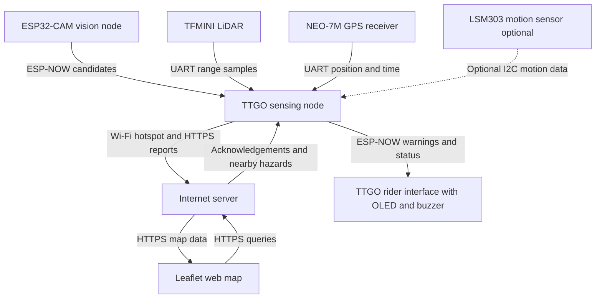

# SOEN-422-Project : Pothole Detection and Sensing System

**SOEN 422 Final Project Proposal Fall 2026**

Prepared by Leon Kojakian, Viktor Dimitrov, and Basma Ennajimi

## Problem

Micromobility supports short trips and connections to public transit, but its adoption depends partly on safe infrastructure [1]. Connected sensors can help micromobility users and infrastructure operators share safety information [2]. For cyclists and scooter riders in Montreal, potholes can destabilize the vehicle and force sudden manoeuvres. Maintenance teams also need recent, geographically useful evidence to decide where to inspect and repair the road.

Manual reporting requires someone to notice, locate and submit each defect. Our project addresses how to collect repeatable evidence of potential potholes during micromobility trips and share it with other riders and maintenance staff. The design must account for inexpensive sensors, vehicle motion, uncertain GPS positions and intermittent Internet access. The City of Montreal and shared-fleet operators are potential users; no operational partnership is assumed.

## Proposed Solution

We propose a removable sensing module for a bicycle or scooter, an Internet server and a separate handlebar alert unit. A kit TTGO ESP32 reads a downward-facing TFMINI LiDAR and a NEO-7M GPS receiver. It detects sustained increases in range relative to a calibrated road baseline. An auxiliary ESP32-CAM runs a small pothole candidate detector and sends timestamps and confidence scores over ESP-NOW. We will train it on attributed public and team-collected road images and align its viewing region with the LiDAR beam. The TTGO compares observations within a calibrated time window and labels reports by the available evidence: range, vision, or both. Range changes indicate possible depressions; they are not precise pothole-depth measurements.

The sensing TTGO sends event IDs, ride IDs, timestamps, GPS quality and sensor evidence to the server over HTTPS using a phone hotspot. The server rejects duplicate events, groups nearby observations using a radius calibrated against GPS error, and marks a location as corroborated after three distinct rides, with at most one vote per ride. Corroboration increases confidence but does not certify a defect. A Leaflet map displays location, evidence, report count and last observation time.

The server returns acknowledgements and nearby corroborated hazards to the sensing TTGO. Using its current GPS position, the TTGO sends warning commands and connection status to the rider TTGO over ESP-NOW. The latter provides an OLED interface and buzzer. A bounded memory queue retries unacknowledged reports after brief outages. Loss of GPS or connectivity is shown explicitly, and warnings remain advisory.

**Objectives** Demonstrate the full sensing-to-map-to-warning loop; target at least 80% precision and 70% recall in 40 labelled, held-out test passes, including depressions and non-defects; and target map updates within five seconds on a working connection. Test a 60-second Wi-Fi outage and verify that retries create no duplicate map events. These are validation targets, not achieved results.

## Initial Design

*Figure 1  Functional components, input data, uplink reports and downlink warnings*

The TTGO firmware separates sensor acquisition, event processing and communication using scheduled tasks and queues. The server performs decisions across rides rather than merely storing data. We request approval for the joint three-student system and the auxiliary ESP32-CAM; the kit TTGOs remain essential to sensing and alerts.

## Hardware

| Component and quantity | Function | Source |
| --- | --- | --- |
| 2 TTGO ESP32 boards | Sensing gateway and rider interface | Course kits |
| 1 ESP32-CAM | Local image capture and candidate detection | Lab extras; approval required |
| 1 TFMINI LiDAR | Road-distance measurements | Lab extras |
| 1 NEO-7M GPS receiver | Coordinates, time and fix quality | Team supplied |
| 1 buzzer and TTGO displays | Audible warnings and operating status | Kits or lab; verify displays |
| 1 LSM303DLHC optional | Acceleration and magnetic-field logging | Lab extras |
| 2 USB power banks and wiring | Power for sensing assembly and alert unit | Lab extras |
| Mounts and protective housing | Secure attachment and cable protection | Team supplied or lab extras |

Lab items are listed in the supplied inventory [3]. We will request them immediately and verify availability, board variants and electrical compatibility. Borrowing the camera and LiDAR limits purchases to missing GPS or mounting parts.

## Feasibility and Safeguards

The initial prototype covers dry surfaces at walking speed with the sensor beam crossing the test defect. Tilt, shallow or water-filled holes and poor lighting remain limitations. We will calibrate range noise and camera timing, hold out entire test runs, and compare range-only and combined detection.

Secure mounting, USB power banks, per-device authentication and road-facing images processed locally address safety and privacy. Raw images and continuous rider tracks will not be published.

## Team Responsibilities

The project is divided into three contributions: vision, training data and camera firmware; range/GPS acquisition, fusion and report buffering; and server decisions, the map and rider firmware. Basma, Viktor, and Leon will share interface design, integration, testing and demonstration, with each member responsible for demonstrating their embedded contribution.

## Milestones and Demonstration

By November 15, demonstrate the range/GPS/map/alert loop and submit the one-page check-in. Integrate vision by November 23; seek approval for any scope change if it is not viable.

Complete testing, source code and the five-minute video by November 30 at 23:59. Submit three presentation slides by December 1 at noon and demonstrate during the assigned December 1–3 or 8–10 session. Indoor testing uses a physical depression mock-up and clearly labelled replayed GPS data.

## References

[1] R. L. Abduljabbar, S. Liyanage and H. Dia, “The role of micro-mobility in shaping sustainable cities: A systematic literature review,” Transportation Research Part D, vol. 92, 102734, 2021. doi:10.1016/j.trd.2021.102734.

[2] M. Schrapel et al., “First Workshop on Connected Micromobility for Safe and Sustainable Communities,” AutomotiveUI Adjunct, 2024. doi:10.1145/3641308.3677395.

[3] SOEN 422, F2026 Additional Component Inventory, Extra Components sheet. Requirements and dates follow Final Project Guidelines, Fall 2026, and the supplied project rubric.
